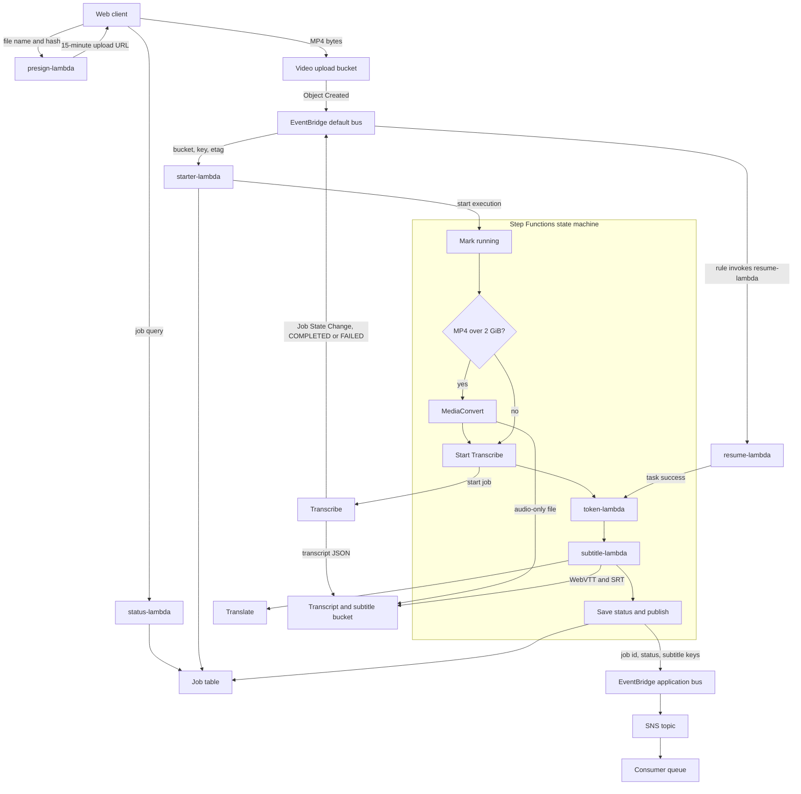

# Architecture

The pipeline turns speech in an MP4 into English, German, and Spanish subtitle files. The video file is not rewritten. An MP4 over 2 GiB is the exception: MediaConvert writes an audio-only file, and Transcribe reads that. The uploaded MP4 is still what the web client plays. Everything is in `eu-central-1`. There is no VPC.

The web client and the two function URLs share the CloudFront hostname. The function URLs require IAM, and CloudFront is the caller. Other teams do not appear in the diagram as callers of the state machine. They subscribe to the bus or to the consumer queue. The decision records are [0001](architecture-decision-records/0001-storage.md) through [0006](architecture-decision-records/0006-same-video-one-job.md). The step-by-step path is the [workflow](workflow.md). The longer walk, with cost and trade-offs at the end, is [How one video becomes subtitles](../understanding-the-pipeline.md).
