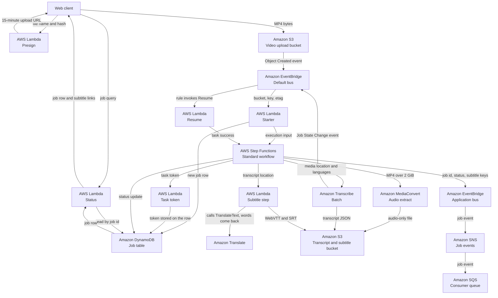
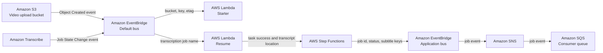
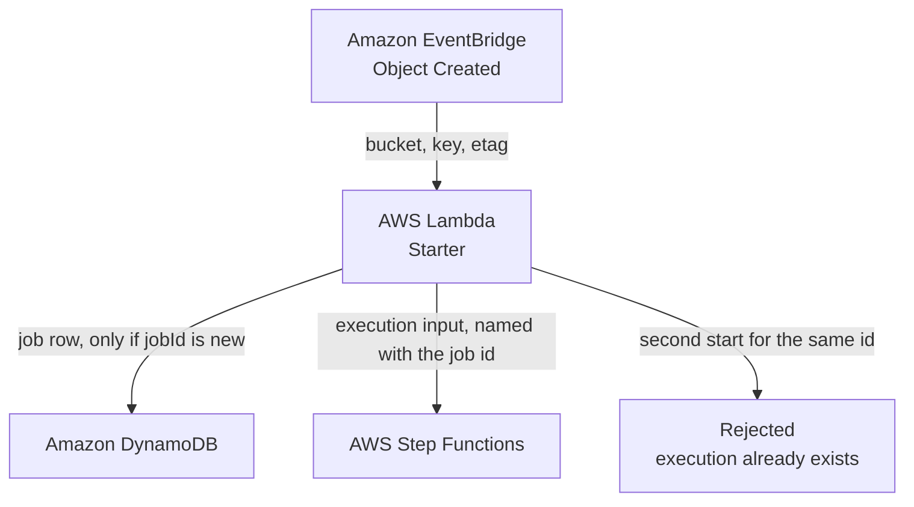
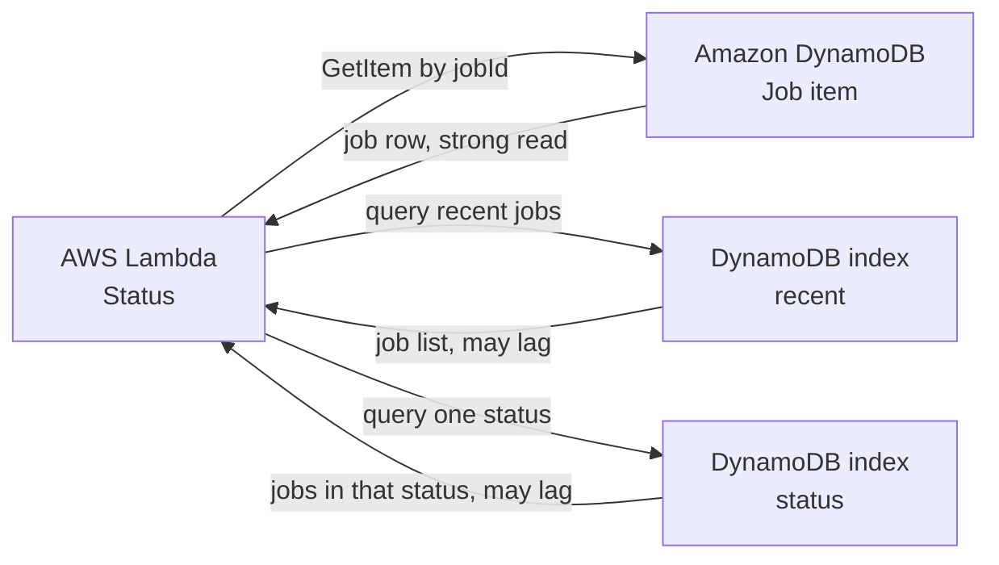
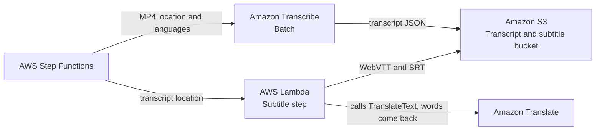
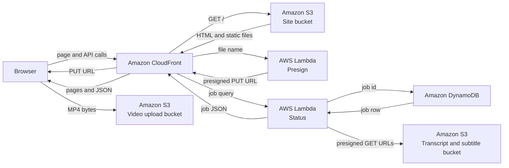
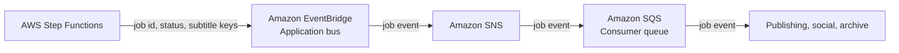
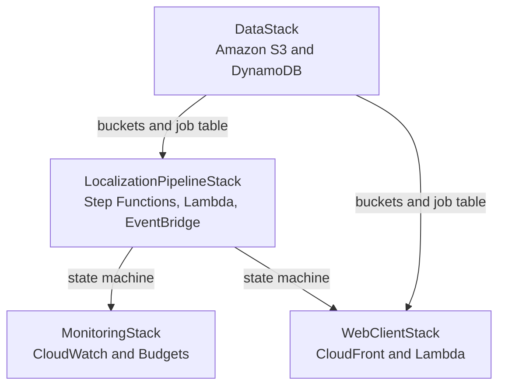
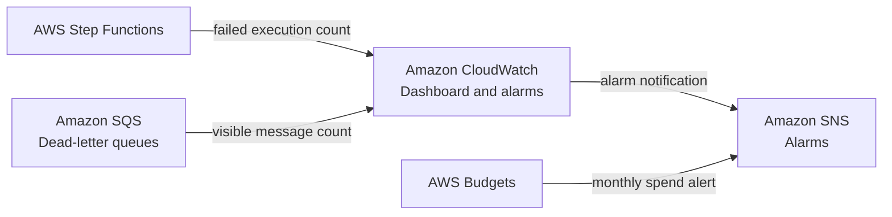

# Speech in, subtitle files out

This is the page to read before the presentation, and the page to leave open if someone asks a follow-up. The slides in [presentation.pptx](presentation.pptx) are the same story with fewer words. The decision records, the workflow, and the reference pages stay where they are. This page is the walk from the web client to the last queue.

Bundesliga source video has to reach fans, broadcasters, and partners in more than one language. The case study asks for an AWS architecture that listens to the speech, translates it, and produces subtitle files. The design is the work: the diagram, the decisions, the workflow, and the limits we accepted. The CDK pipeline is the same design, written so it can be deployed from a laptop.

The properties a reviewer is listening for are named in the next sections. The design is serverless. It moves because events happen. The same upload cannot start two jobs. The detail page reads a fresh row, and the lists are allowed to lag by about a second.

## The whole pipeline

One MP4 comes in. Six subtitle files and one event go out. The video file is not rewritten.

The sections below take one part of this picture at a time. The [workflow](explanation/workflow.md) is the same path in sentences.

## What the brief asks, and where it is answered

| The brief                                   | Where this design answers it                                                                  |
| ------------------------------------------- | --------------------------------------------------------------------------------------------- |
| Transcribe the speech in the video          | Amazon Transcribe batch reads the MP4 from the video upload bucket                            |
| Translate that speech                       | Amazon Translate, one cue at a time, asked to keep the line short                             |
| Produce subtitle files                      | WebVTT and SRT for English, German, and Spanish                                               |
| At least one of those languages             | All three. A cue already in one of them is copied                                             |
| The source is described as German           | Detection is limited to `en-US` and `de-DE`, because the samples are English, mixed, or both  |
| A person can try the flow and see a failure | Static site: upload, status, a gallery of finished jobs, and the reason on a failed one       |
| Another team can take the result            | One event on an application bus. They subscribe. They do not receive a grant on the job table |
| The same upload is not processed twice      | A stable job id, a conditional write, and an execution name that rejects a second start       |
| Status survives a refresh                   | One DynamoDB item per job, read strongly on the detail page                                   |
| Say what it costs to leave running          | No servers, no VPC, no database instance, no custom domain, no firewall                       |
| Say what you would do next                  | A review loop, burned-in graphics, login, and a live socket                                   |

## Serverless

Nothing in this pipeline is a server we patch. When the video upload bucket is empty, there is no task, no database instance, and no NAT gateway billing for the privilege of existing.

The moving parts are Lambda, Step Functions, S3, DynamoDB on demand, Transcribe batch, Translate, EventBridge, SNS, SQS, and CloudFront. Each one bills for a request, a state transition, a gigabyte, a second of audio, or a character. The site is a static export of a Next.js app. There is no Next.js server and no container.

Two options were set aside on purpose.

Express workflows are serverless, and they are the wrong workflow. They stop at five minutes, they run at least once, and they cannot wait on a task token. A batch transcription is longer than that, and it must not run twice. Standard workflows can sleep until Transcribe finishes. Waiting is one state transition, not a loop.

A Next.js server on Fargate, and a job table on RDS or Aurora, would be running on the days nobody uploads. A job row is one item with a known key. It does not need an instance. The [storage decision](explanation/architecture-decision-records/0001-storage.md) and the [orchestration decision](explanation/architecture-decision-records/0002-orchestration.md) record that trade.

## Event-driven

The pipeline moves because something happened. It does not sit in a loop asking whether the previous step has finished.

The upload button does not start the job. The MP4 landing in the video upload bucket emits Object Created on EventBridge, and that event starts it. A failed upload never becomes a job, because the job starts from the object, not from the click.

Transcribe emits Job State Change when the transcript is ready or the attempt has failed. The resume function loads the wait token stored on the row and wakes the state machine. The machine does not call `GetTranscriptionJob` on a timer. If the four-hour wait ends first, it reads the transcription job once, and only then.

When the job reaches a terminal status, the machine publishes one event to an application bus. A rule fans that event out to an SNS topic, and a queue is subscribed to the topic. Publishing, social, and archive systems subscribe there. Object Created and Transcribe Job State Change stay on the default bus. They are internal. They are not the contract other teams see.

The page is the one place that polls, every two seconds, and only while the status is `received` or `running`. That poll reads the job row and, on the job page, the stages of the latest run. It is not how the pipeline waits for speech. A transcription takes minutes, so a two-second gap does not change when the subtitles appear. A WebSocket can be a subscriber on the same bus later, which is the [edge decision](explanation/architecture-decision-records/0004-edge.md).

## One upload, one job

The same object must not start two transcriptions. The id we already have to store the job is also the lock.

The job id is a hash of the bucket, the object key, the etag, the profile, and the output language list. The same inputs always produce the same 32-character id. A second delivery of Object Created for that file is the same job, not a new one.

The starter inserts the row only when that id is new. The condition is `attribute_not_exists(jobId)`. The second writer loses the race and does not create a second row.

The Step Functions execution is named with that same id. A second `StartExecution` comes back as already exists, and the starter stops. The execution name is the idempotency key for the workflow.

A duplicate Transcribe completion finds a task token that is already closed, and the resume function ignores it. Downstream, SNS and SQS deliver at least once, so a subscriber treats the job id as its own key. The subtitle files are written once. The message about them may arrive twice.

A rerun with `en-US` or `de-DE` forced by hand is a new execution on purpose. A finished Transcribe job name cannot be reused, so that run gets a new transcription name. It is the same video being tried again with a language the operator chose. It is not a second copy of the first attempt.

## What is consistent, and what can lag

The detail page has to show the status that was just written, including after a refresh. That read is strongly consistent. So is the read the starter does when the row is already there, and so is the read that loads the wait token.

The jobs list, the gallery, and the failures page query indexes. The jobs page reads every job under the group name `job`. The gallery reads the `completed` group, and the failures page reads the `failed` group. Those indexes are eventually consistent, so a list can lag the detail page by about a second. One group name is enough for this client. A high-rate public catalogue would split the name by day, query today and yesterday, and merge to the newest 50. The [storage decision](explanation/architecture-decision-records/0001-storage.md) records that.

A status update is conditional. The machine sets `running` only from `received` or `running`, and it sets a terminal status only from `running`. A late or repeated step cannot overwrite a job that has already finished.

The outcome event is at least once, not exactly once. If the bus cannot deliver, the files are already in the transcript and subtitle bucket, and a partner reads them from the key on the row after the notification is replayed.

## Why these services

Each row is the need, the service that meets it, and the option that was set aside. The pricing unit is the reason the standing charge lost. The worked rates and the 5-minute example are in [How one video becomes subtitles](understanding-the-pipeline.md#cost-and-trade-offs).

| Need                                                  | Service                                            | Why this one                                                                                                                                                                                                     | Set aside                                                                                                                                         |
| ----------------------------------------------------- | -------------------------------------------------- | ---------------------------------------------------------------------------------------------------------------------------------------------------------------------------------------------------------------- | ------------------------------------------------------------------------------------------------------------------------------------------------- |
| The video and the subtitle files                      | S3, three private buckets                          | Objects with unknown keys at deploy time. A separate transcript and subtitle bucket keeps the transcription role from writing next to the source                                                                 | One bucket with prefixes. It works, and it mixes the two grants                                                                                   |
| One status per job, found by id                       | DynamoDB, on demand                                | One item, a known partition key, a conditional write, and two indexes for the pages. Billed per read and per write. Point-in-time recovery is on. Encryption is the AWS-managed key                              | RDS or Aurora. An instance is a monthly charge for a row whose key we already know                                                                |
| A job that lasts minutes and must run once            | Step Functions, Standard                           | It waits on a task token. The execution name rejects a duplicate. Waiting is one transition. The published free tier is 4,000 transitions a month                                                                | Express workflows. A Lambda loop that polls Transcribe, which can start a second transcription on retry                                           |
| Speech to timed text                                  | Amazon Transcribe, batch                           | It reads an MP4 of 2 GiB or less, or an audio-only file when the MP4 is larger, identifies `en-US` or `de-DE`, and can label speakers up to a ceiling. Priced per second of audio. That is the cost that matters | MediaConvert on every file. It is used only above Transcribe's 2 GiB limit. A reserved MediaConvert queue is a 12-month charge and stays off      |
| The words in the other languages                      | Amazon Translate                                   | The timestamp is copied, not translated. Standard text is priced per character. The published rate is $15 per million characters. The line is asked to stay short                                                | A language model on every cue. A second cost on the path that already dominates the bill                                                          |
| Wake the next step                                    | EventBridge                                        | Object Created and Job State Change are events the services already emit. Rules have dead-letter queues                                                                                                          | A queue between every stage of one job. The 250-job cap, if it fills, uses Transcribe's own waiting line                                         |
| Tell another team, without handing them the table     | An application bus, an SNS topic, and an SQS queue | They add a rule, or they read the queue. The event carries the job id and the object keys                                                                                                                        | A presigned URL in the event, which would expire in the queue and be copied into logs. A direct read of DynamoDB, which couples them to this item |
| A site with two calls and no login yet                | CloudFront and two Lambda function URLs            | The pages and the API share a hostname. CloudFront signs the calls. Function URLs have no gateway fee                                                                                                            | API Gateway, which earns its place when a JWT authorizer is required. A container, which these pages do not need                                  |
| Know that a run failed or the month crossed a ceiling | CloudWatch, one dashboard, alarms, a budget        | Lambda, Step Functions, and the dead-letter queues already write their counts here                                                                                                                               | A second product that copies the same signals out of AWS and adds a bill                                                                          |

## What a finished job is

A person uploads an MP4 of at most 5 GB. A few minutes later the transcript and subtitle bucket holds six files: English, German, and Spanish, each as WebVTT and as SRT. The video file is the same file they uploaded. A file over 2 GiB is transcribed from an audio-only copy. We do not paint words onto the picture, and we do not replace the audio.

A cue is one subtitle: the words shown between a start time and an end time. Timestamps stay on the cue. Translation changes the words, not the moment they appear.

The reviewers named English, German, and Spanish as subtitle languages, and one of those three files would have met the brief. We write all three. Spanish is a subtitle file only. A line already in one of the three is copied, and the other two are translated.

## Why the pipeline detects the language

The brief describes German source video. The files on hand do not all match that. Highlights are English. The interview is English and has two speakers. The feature mixes German and English and has several speakers. A pipeline that assumes one German soundtrack would pass one sample and miss the others.

Transcribe is allowed to choose only `en-US` or `de-DE`. That is the whole allow-list. Every profile may identify English, German, or both inside one file, and translation then follows each cue.

## What the operator sees

The test UI is a Next.js site built as a static export. There is no Next.js server. CloudFront serves the pages from a private bucket and sends two paths to Lambda on the same hostname:

- `/api/uploads` asks for a place to put the file
- `/api/jobs` reads status, lists jobs, and can rerun one that needs a language chosen by hand

The browser never holds AWS keys. The function URLs require IAM, and CloudFront is the caller.

Five pages are enough to try the flow.

| Page     | What it is for                                                                                        |
| -------- | ----------------------------------------------------------------------------------------------------- |
| Home     | The short version of the flow, and the reminder that a local dev server has no API behind it          |
| Upload   | Pick an MP4. The file goes straight to the video upload bucket                                        |
| Jobs     | Recent jobs, including ones that need review and ones with no speech                                  |
| Gallery  | Jobs that finished and have subtitle files                                                            |
| Failures | Jobs that stopped with an error, and the reason                                                       |
| Job      | One job, at `/job?id=`. The id does not exist when the site is built, so it lives in the query string |

While a job is `received` or `running`, the detail page asks again every two seconds. A finished job plays the video and offers the six files through links that expire in fifteen minutes.

A local `npm run dev` can show the pages. The API exists only behind the deployed CloudFront hostname. The stack output `ConsoleUrl` is that hostname.

## The path of one video

The diagram at the top is this path. A cue is one subtitle: the words shown between a start time and an end time. The subtitle step groups the transcript into cues, copies a cue that is already in English, German, or Spanish, and asks Amazon Translate to keep the others short. AWS Step Functions is the only writer of `status`.

## Three profiles, one pipeline

The file name selects the profile. The stage file is the list of legal profiles. Today that list is:

| Profile      | What Transcribe is asked to do                      |
| ------------ | --------------------------------------------------- |
| `highlights` | English, German, or both. No speaker labels         |
| `interview`  | English, German, or both. Speaker labels, ceiling 3 |
| `feature`    | English, German, or both. Speaker labels, ceiling 6 |

Labels are anonymous: `spk_0`, `spk_1`, and so on. Naming the person would need a face roster or a celebrity index, and face data is a separate privacy decision. A voice beyond the ceiling is merged into an existing label. When the result uses every slot, the job is marked saturated, because a voice may have been split or merged and a person should look.

## What the other teams receive

Publishing, social, and archive systems build on the finished job. They do not call the state machine, they do not call Transcribe or Translate, and they do not read the job table.

When a job reaches a terminal status, the machine publishes one event to an application bus. The source is `bundesliga.localization`. The detail types are:

| Event                        | When it fires                                        |
| ---------------------------- | ---------------------------------------------------- |
| `LocalizationJobCompleted`   | Subtitle files were written                          |
| `LocalizationJobFailed`      | The job stopped with an error                        |
| `LocalizationJobNeedsReview` | Language confidence was below 0.8. No subtitle files |
| `LocalizationJobEmpty`       | The file had no speech                               |

The detail carries version 1, the job id, the profile, the detected language, the reason, and the subtitle keys. It does not carry a presigned URL. A URL would expire in the consumer's queue and would be copied into logs. The consumer's role is granted read on `subtitles/*` when that team is allowed to fetch the file.

A rule on the bus publishes to an SNS topic. A queue is subscribed to that topic. Email is not subscribed. SNS and SQS deliver at least once, so the consumer treats the job id as the idempotency key.

Another team uses the pipeline in one of these ways:

1. Add an EventBridge rule on the application bus for source `bundesliga.localization`. Their target can be their own function, queue, or bus.
2. Read the consumer queue that is already subscribed to the topic. The message body is the job event.
3. When the event says the files exist, read `subtitles/{jobId}/{lang}.vtt` and `.srt` from the transcript and subtitle bucket. Their role needs read access on `subtitles/*`. The event carries those keys. It does not carry a URL.

A second delivery of the same job id is the same job. Their handler ignores a job id it has already accepted. Object Created and Transcribe Job State Change stay on the default bus. Those events are internal. They are not this contract.

## How the infrastructure is cut

Everything is in `eu-central-1`. There is no VPC. Transcription, translation, storage, and the workflow are regional managed services, and they already run across availability zones. A VPC would add a NAT gateway, which is a monthly charge even when no video is processed.

`cdk deploy` runs from a laptop. There is no GitLab or GitHub Actions pipeline. One stack, `LocalizationStack`, creates four stacks and passes the buckets, the job table, and the state machine between them. Data deploys first, then the pipeline, then monitoring and the web client.

**Data.** Three private S3 buckets. The video upload bucket receives `video-upload/{profile}/{id}.mp4` and has EventBridge turned on. The transcript and subtitle bucket holds `transcripts/{transcriptionJobName}.json` and the subtitle files. A third bucket stores access logs for the media buckets and the site bucket. Buckets block public access, require TLS, and encrypt with SSE-S3. A customer-managed KMS key would be a standing monthly charge, so this demo does not create one.

The job table is DynamoDB, billed on demand, one item per job. The job id is how the detail page fetches one row. The `recent` index lists every job for the jobs page. The `status` index lists one status, which is how the gallery and the failures page stay separate. Point-in-time recovery is on. The detail page reads with a strongly consistent get. The list pages can lag that read by about a second. Dev deletes the buckets with the stack. Prod retains them and turns on deletion protection for the table.

**Pipeline.** A Standard Step Functions state machine owns the job. Express workflows stop at five minutes, run at least once, and cannot wait on a task token, so they are the wrong tool for a transcription that takes minutes and must not run twice. The machine does not poll Transcribe. Waiting is one state transition. The wait is capped at four hours, which is the batch limit of the file Transcribe accepts.

The functions on this path are small and single-purpose: start the workflow when the object lands, store the wait token, wake the machine when Transcribe finishes, and write the translated subtitle files. Each function has its own role. Presign may only `PutObject` on `video-upload/*`. The subtitle writer may read transcripts, write `subtitles/*`, read the transcription job, and call Translate. Translate has no resource-level ARN, so that one action is the exception to an otherwise closed role.

There is no queue between the stages of a single job. Transcribe allows 250 batch jobs at once. A queue of our own stays off. If that cap fills, the later control is Transcribe's `AllowDeferredExecution`.

**Monitoring.** Lambda, Step Functions, and the dead-letter queues already write logs and counts to CloudWatch. The stack adds a dashboard, an alarm when an execution crashes, an alarm when a job is stored as failed, an alarm on each dead-letter queue, and a monthly budget.

The amount is `budgetUsd` in the stage file, 25 dollars in both stages. That number is a ceiling, not a price for a service. The consumer queue is not alarmed when it has messages. A partner may not be attached yet, and a waiting message is expected. Dead-letter queues are alarmed. The workflow log level is ALL, and the log omits the execution payload so the task token is not copied into CloudWatch.

**Web client.** A private bucket for the static export, a CloudFront distribution, and two function URLs. `/` is the site, `/api/uploads` is presign, `/api/jobs`* is status. The distribution uses price class 100 and the hostname CloudFront already provides. That hostname already has HTTPS. A custom domain, a hosted zone, a certificate, and a web application firewall stay off while `deployCustomDomain` is false, because each one is a monthly charge for a demo that has no domain of its own.

Stage behavior lives in `infra/config/config.dev.yml` and `config.prod.yml`: names, languages, profiles, cue length, the confidence floor, the poll interval, and the feature flags. The account and the region come from `infra/.env` only. Synth fails when `AWS_ACCOUNT_ID` or `AWS_REGION` is missing. The runtime slice of the YAML is handed to each function as `CONFIG` at deploy time.

Physical names follow `{service}-{name}-{purpose}-{stage}` from `resourceName()`. Here that begins `bundesliga-localization-`.

## What happens when it goes wrong

A conditional write rejects a second row for the same object, profile, and language list. A duplicate completion event finds a closed token and stops. Each rule that listens for upload events, Transcribe events, or the fan-out has a dead-letter queue.

A failed transcription stores the service reason on the job and publishes `LocalizationJobFailed`. Translate errors fail the job after the transcript exists, so the run can still be inspected. If the bus cannot deliver to the topic, the event lands on the fan-out dead-letter queue and the alarm fires. The subtitle files are already in the transcript and subtitle bucket. A partner can read them from the key on the job row after the notification is replayed.

The web client shows the JSON error from the function. Anyone who can open the hostname can request an upload URL. A user pool and a JWT check can sit in front of the same two functions later. API Gateway is the place for that authorizer. It is not required for two routes and no login, and function URLs have no gateway fee.

## Trade-offs

The full list is in [Trade-offs](explanation/trade-offs.md). One of them sits on the media buckets, and it is the question people ask when they see `allowedOrigins: ["*"]`.

The web client uploads the MP4 straight to S3, then later plays the video and downloads the subtitle files. Those calls leave the CloudFront hostname, so the buckets tell the web client the call may finish. The upload bucket allows `PUT` and `HEAD`. The transcript and subtitle bucket allows `GET` and `HEAD`.

`allowedOrigins` is `*`. The hostname CloudFront assigns appears only after the distribution exists, and the distribution is built from these buckets. Naming that hostname on the bucket would make each wait for the other. A local Next.js session is a second origin, `http://localhost`.

The objects stay private. Block Public Access stays on, and S3 still checks the signature on the presigned URL. That URL expires in 15 minutes. The rule only lets the web client complete a request that already carries a valid URL. A domain written in config can replace `*` once `deployCustomDomain` is true, because that name is chosen before the distribution exists.

## What we left for a later decision

These are limits, chosen because the brief asks for subtitle files or because the extra piece has a standing cost.

- **Banners stay in the picture.** A lower-third, a club crest, a "youngest goalscorer" graphic: those words are drawn into the frame. Translating them means a new video. The mission asks for subtitle files, so the banner stays in the original language.
- **Amazon Translate is the translator.** A language-model rewrite would be a second cost on the path that already dominates the bill. Transcribe batch is priced per second of audio. Translate standard text is priced per character.
- **MediaConvert is only for a file over 2 GiB.** It writes an audio-only MP3 so Transcribe can read a file past the 2 GiB batch limit. The uploaded MP4 is still what plays. Evened-out volume and burned-in captions stay off. Both of those flags exist in the stage file and are false. A reserved MediaConvert queue is a 12-month charge and stays off.
- **One upload, up to 5 GB.** The same file, measured by its SHA-256, size, profile, and subtitle languages, is one job. A larger file needs multipart upload. SHA-256 of a multipart object depends on the part boundaries, so that path is later and would use CRC-64/NVME for the whole file.
- **Polling, not a socket.** A transcription takes minutes. A two-second delay before the page flips to done does not change when the subtitles appear. A WebSocket API can be a subscriber on the event bus later.
- **MP4 only, up to 5 GB.** The site accepts a file whose name ends in `.mp4`. Other containers are a later step, and that step has to confirm Transcribe can read them.
- **Review is a first draft.** Low confidence stops before translation and is stored as needs review. The web client can force one language, which transcribes again, or accept a transcript that already contains both. A person cannot yet correct a line and feed that correction back into a vocabulary. That loop is what makes the subtitles broadcast-quality. This version produces the draft and surfaces the failure. Wrong words and a speaker label that stays on the previous voice are in [Known issues](explanation/trade-offs.md#known-issues).
- **No second monitoring bill.** A platform such as Datadog would copy the same CloudWatch signals out of AWS. This demo needs to know that an execution crashed, that a job was stored as failed, that a dead-letter queue received a message, and that monthly spend crossed the ceiling.

## How to talk through it

Open on the sentence the system earns: speech in, six subtitle files out, the video left alone. Show the whole-pipeline diagram first, then the smaller diagram for the question they ask. Walk from the web client down to the consumer queue without naming every IAM action. Then take questions in this order, because it is the order people actually ask.

1. Show me serverless. Nothing runs until a file arrives. No instance, no container, no NAT gateway.
2. Show me the events. Object Created starts the job. Job State Change wakes it. One outcome event leaves the pipeline. The page poll is only a status read.
3. How do you avoid a duplicate job? Same inputs, same id. Conditional insert. Execution name rejects the second start. A closed token ignores a second completion.
4. What is consistent? The detail page is a strong read. The lists can lag by about a second. The event is at least once, and the job id is the key.
5. Why DynamoDB? One item, a known key, a conditional write, billed per request. An RDS instance would charge on the days nobody uploads.
6. Why detect the language? The samples are English, mixed, or both, and the brief said German.
7. What did you leave for later? A review loop, burned-in graphics, login, a socket, a domain, and a firewall.
8. Why can any website call the buckets? The web client talks to S3 directly. The CloudFront hostname is not known when the buckets are defined. The signed link, for 15 minutes, is the lock.

If they want the exact contract after the room, send them to [how one video becomes subtitles](understanding-the-pipeline.md), the [workflow](explanation/workflow.md), the [trade-offs](explanation/trade-offs.md), the [decisions](explanation/architecture-decision-records/0001-storage.md), and the [event reference](reference/events.md).