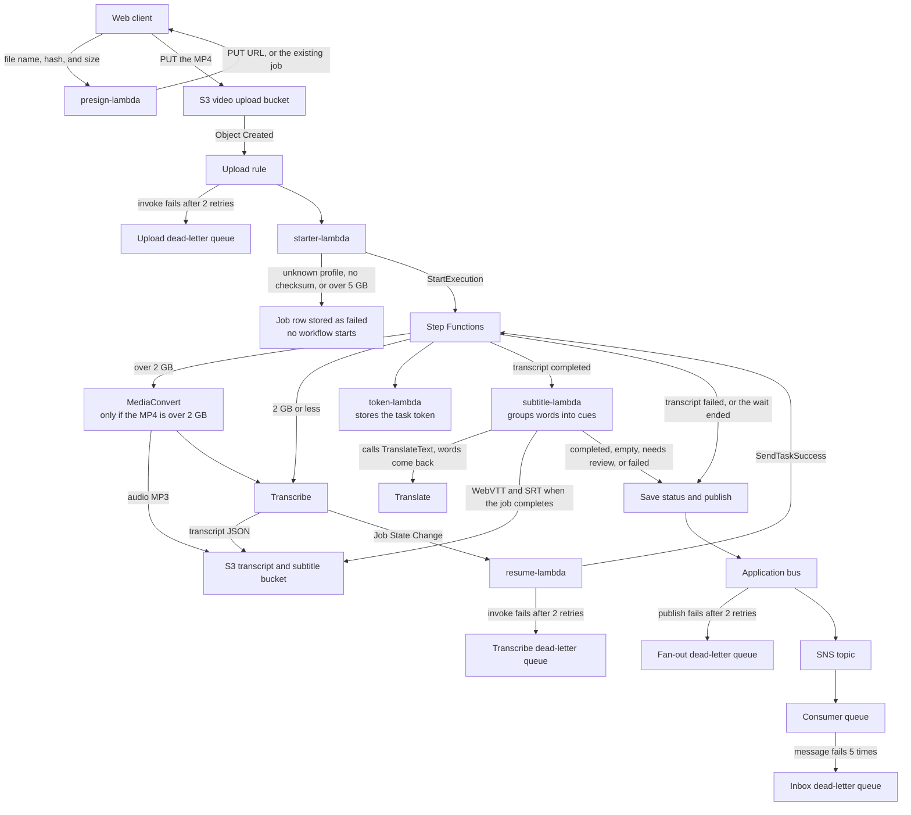
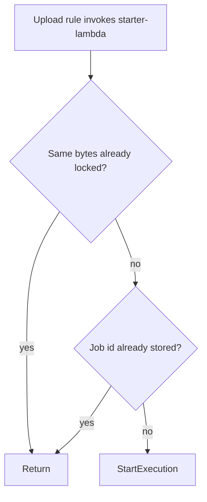
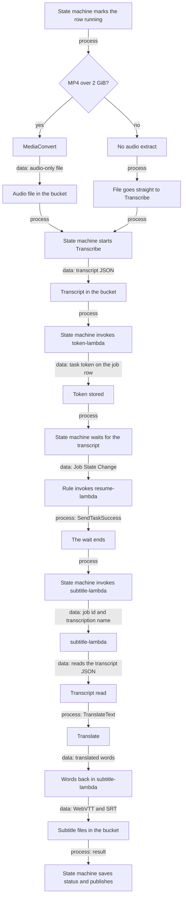
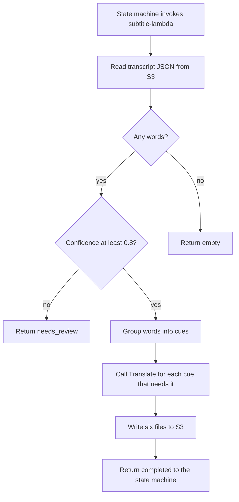
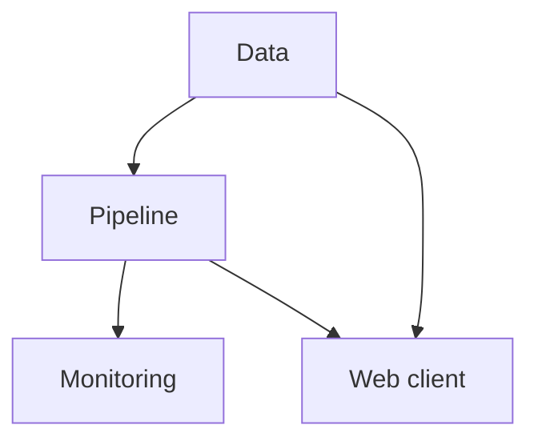

# How one video becomes subtitles

This page follows one MP4 from the web client to the last queue. It stays on the path the file takes. What a job costs, and what this version leaves out, is the last section, [Cost and trade-offs](#cost-and-trade-offs).

The same path in fewer sentences is the [workflow](explanation/workflow.md). Exact settings are in the [reference](reference/resources.md).

## What comes out

Speech goes in. Six subtitle files and one event come out. The uploaded video stays as it was.

A cue is one subtitle: the words shown between a start time and an end time. Translation translates the text to the configured langauges, for this demo en, de and es. The timestamps stay.

A finished job writes into the transcript bucket under the subpaths transcripts and subtitles (in en, es and de):

- `subtitles/{jobId}/en.vtt` and `subtitles/{jobId}/en.srt`
- the same pair for `de`
- the same pair for `es`

The video stays at `video-upload/{profile}/{id}.mp4` in the video upload bucket.

## Words used below


| Word         | Meaning                                                                                                                                                                                                                                                                                                                                                                                                                                                    |
| ------------ | ---------------------------------------------------------------------------------------------------------------------------------------------------------------------------------------------------------------------------------------------------------------------------------------------------------------------------------------------------------------------------------------------------------------------------------------------------------- |
| Profile      | How the file should be treated. The name is the word after the last underscore, as in `sample_02_interview.mp4`. The current config allows `highlights`, `interview`, and `feature`.                                                                                                                                                                                                                                                                       |
| Job id       | Built when MP4 lands in bucket. Takes bucket name, object key, object etag, profile and subtitile langauage, generates a SHA-256 hash and takes the first 32 characters.                                                                                                                                                                                                                                                                                   |
| ETag         | The tag S3 returns for the stored object. The job id includes it, so a second delivery of the same upload event is the same job.                                                                                                                                                                                                                                                                                                                           |
| Task token   | Step Functions creates this token when the workflow pauses to wait for Transcribe. It passes the token to token-lambda, which stores it on the job row. When Transcribe finishes, resume-lambda sends that same token back, and that is what lets the workflow continue.                                                                                                                                                                                   |
| Content lock | A second item in the same job table. The real job uses a 32-character jobId. The lock uses a 64-character hash of the file contents, the size, the profile, and the subtitle languages in that same column. The lock item has two other fields: kind set to content, and targetJobId set to the real job. Uploading the same video again finds that item and follows targetJobId, so it does not start another job. The file name is not part of the hash. |


## The path

Two buses move the work. The default bus carries events that S3 and Transcribe already publish. The application bus carries the one event this pipeline publishes when a job reaches a terminal status. A rule on a bus invokes the next function. If that delivery fails, the event lands on a dead-letter queue. The same steps are written out in [the state machine section](#4-the-state-machine-waits-for-the-transcript).




## 1. The web client asks for an upload URL

The site is a static Next.js export in a private bucket. CloudFront reads those pages when the web client asks for them.

The upload call takes the same hostname, then the bytes leave it:

1. The web client sends `POST /api/uploads` to CloudFront. The body is the file name, the SHA-256 of the whole file, and the size.
2. CloudFront signs that call and invokes the presign function URL. The function URL requires IAM, so a caller who only has the URL cannot invoke it.
3. The presign function reads the profile from the file name. An unknown profile is rejected. A file over 5 GB is rejected. It then reads the job table. If a job already holds that hash, size, profile, and subtitle languages, it returns that job and the web client does not upload again.
4. Otherwise it signs a PUT URL for the video upload bucket, at `video-upload/{profile}/{id}.mp4`. The URL expires in 15 minutes. The id in the key is random. The file name is stored as object metadata. The file name is not the job id.
5. The web client `PUT`s the MP4 bytes straight to that bucket with the URL. Those bytes do not go through CloudFront. S3 checks the signature and the SHA-256 on the PUT. A hash that does not match the bytes is rejected.

Files larger than 5 GB, and the checksum that would identify them, are in [Files stay at 5 GB, in one piece](#files-stay-at-5-gb-in-one-piece).

## 2. The object starts the job

The upload button asks for the URL. It does not start the state machine. The machine starts only after the object exists, and only because an event says so.

1. S3 publishes `Object Created` on the EventBridge default bus. The video upload bucket is the only bucket in this stack with that notification turned on.
2. The upload rule on that bus matches source `aws.s3`, detail type `Object Created`, this bucket, and keys under `video-upload/`.
3. The rule invokes starter-lambda and passes the event. The event carries the bucket, the key, and the ETag. If the invoke fails, the rule retries twice and then writes the event to the upload dead-letter queue.

An upload that never finishes leaves no object. S3 publishes nothing, the rule does not run, and there is no job.

Starter-lambda then reads the object. It ignores a key that is not `video-upload/{profile}/{file}.mp4`, and it returns without throwing, so the rule does not retry that event. For a matching key it reads the profile from the middle segment and calls S3 for the file name, the size, and the checksum.

An unknown profile, a missing checksum, or a file over 5 GB is written to the job table as `failed`. Starter-lambda does not call `StartExecution`.

## 3. One object becomes one job

The upload rule can invoke starter-lambda more than once for the same object. Inside that function, three checks stop a second transcription. Each check happens before the next one.




1. The content lock. Starter-lambda writes a second row whose key is the checksum, the size, the profile, and the subtitle languages. If that row already exists, this object is the same bytes as an earlier upload, and the function returns.
2. The job id. Starter-lambda inserts the job row only when that id is new. A second delivery of the same `Object Created` event loses the insert and returns.
3. The execution name. `StartExecution` uses the job id as the name. If that execution is already there, the call comes back as already exists, and the function returns.

The new row is written as `received`. Status values the pipeline writes are `received`, `running`, `completed`, `failed`, `needs_review`, and `empty`.

Later, the detail page reads that row through the status function. That read is strongly consistent, so a refresh shows the status that was just written. The list pages read two other groupings of the same rows. The jobs page reads the `recent` index, every job under the group name `job`. The gallery reads the `status` index group `completed`, and the failures page reads `failed`. Those lists can lag the detail page by about a second. A busier public list would split the group name by day. The [storage decision](explanation/architecture-decision-records/0001-storage.md) records that.

## 4. The state machine waits for the transcript

Starter-lambda calls `StartExecution`. From here the state machine calls the next service. It is the only writer of `status`. It sets `running` only while the row is `received` or already `running`, and it sets a finished status only while the row is `running`. A late step cannot overwrite a job that has already finished.




Each arrow points one way and has a head. The label says whether that step is process or data. Nothing points backward, so the lines do not cross. The wait does not start subtitle-lambda. `SendTaskSuccess` ends the wait, and the next box is the state machine invoking subtitle-lambda. That function calls Translate. The machine saves the status and publishes the job event on the application bus.

1. TThe state machine’s first state, MarkRunning, updates the job row to `running` by calling DynamoDB directly. via DynamoDB task. Step Functions calls `UpdateItem` on the job table and waits for DynamoDB to answer. The table change is the work of that state, and the machine then moves on to PrepareMedia.
2. If the MP4 is over 2 GiB (PrepareMedia sends a file over 2 GiB to ExtractAudio), the state machine calls MediaConvert and waits until that job finishes. MediaConvert reads the MP4 from the video upload bucket and writes `audio/{jobId}.mp3` to the subtitle path under the transcript bucket. From there the execution goes to Route, the same choice a smaller MP4 reaches directly. Route still picks the Transcribe start state from the profile and from whether a language was forced. Transcribe reads `mediaUri` either way, so a small file is the original MP4 and a large file is the extracted MP3. Subtitles, the outcome, and the event are unchanged after that. If MediaConvert fails, the machine skips Route and goes to the failed outcome. In simple terms, the state machine points Transcribe at that audio file. The uploaded MP4 stays what the web client plays. A smaller file skips this call.
3. The state machine calls `StartTranscriptionJob`. Transcribe reads the media from S3. When it finishes, it writes the transcript to `transcripts/{transcriptionJobName}.json` in the transcript bucket.
4. The state machine invokes token-lambda and passes a task token it generates for the wait state. The Token-lambda then writes that token on the job row and returns. The state machine stays in this step for up to 4 hours. It does not call Transcribe again to ask whether the job is done.
5. Transcribe publishes `Job State Change` on the default bus when the job completes or fails.
6. The transcript rule matches source `aws.transcribe`, detail type `Transcribe Job State Change`, and status `COMPLETED` or `FAILED`. The rule does not filter by job name. Resume-lambda does.
7. The rule invokes resume-lambda. That function reads the job row, checks the token, and calls `SendTaskSuccess`. Step Functions checks that action against the state machine. A permission on the execution does not match. The task token still names the waiting execution. The state machine then leaves the wait and continues. If the invoke fails, the rule retries twice and then writes the event to the transcribe dead-letter queue.

When a second completion event arrives, the resume Lambda calls `SendTaskSuccess` with the token already stored on the row. Step Functions rejects that call because the wait has already ended (`TaskTimedOut`, `InvalidToken`, or `TaskDoesNotExist`). The resume Lambda returns without throwing, so the **TranscriptReady** rule counts the delivery as done and the execution, already past the wait, keeps going.

If that event arrives before the token Lambda has written the token, the resume Lambda throws `Task token for {jobId} is not stored yet`. The rule retries the invoke twice. A later try can find the token and call `SendTaskSuccess`. After those retries, the event is written to the transcribe dead-letter queue.

If the four-hour limit on **WaitForTranscriptReady** expires first, the state machine catches `States.Timeout` and calls `getTranscriptionJob` once in **GetAfterTimeout**. **TimeoutStatus** sends a job whose `TranscriptionJobStatus` is `COMPLETED` straight to **BuildSubtitles**. Any other status goes to **NormalizeTimeout**, which sets the result to `failed` with the reason "Transcription did not finish before the wait ended." **Outcome** then saves that failed status on the row. If `getTranscriptionJob` itself fails, the same failed result is stored.

Every profile in the stage file may be English, German, or both in one file. The candidates are `en-US` and `de-DE`. With those files, the state machine also asks Transcribe for speaker labels. Interview allows 3. Feature allows 6. Highlights does not set a ceiling, so the request asks for 2. Labels are `spk_0`, `spk_1`, and so on.

A language rerun is a new execution on the same job row. The status function calls `StartExecution`. Forcing `en-US` or `de-DE` starts Transcribe again, under a new transcription name, because a finished Transcribe job name cannot be reused. Accepting a transcript that already contains more than one language uses the JSON already in the bucket. That execution does not call `StartTranscriptionJob`.

Why this is a Standard workflow, and what that costs, is in [Why the workflow is Standard](#why-the-workflow-is-standard).

## 5. Words become subtitle files

`SendTaskSuccess` wakes the state machine. The state machine then invokes subtitle-lambda and passes the job id and the transcription name.

1. Subtitle-lambda reads the job row.
2. It calls `GetTranscriptionJob` and reads the transcript JSON from the transcript and subtitle bucket.
3. It writes the spoken languages, the confidence, and whether every speaker slot was used back onto the row.




A score below 0.8 returns `needs_review` before any call to Translate. For a file with more than one language, the score that counts is the lowest one. The web client can then force `en-US` or `de-DE`, or accept a mixed transcript. That choice is a new `POST /api/jobs`, which the status function turns into a new execution.

No words returns `empty`. A silent file does not get blank language tracks.

Otherwise the words are grouped into cues. A new cue starts when:

- the gap since the previous word is more than 0.8 seconds
- the speaker changes
- the language changes
- the line would be longer than 42 characters on 2 lines
- the line would be faster than 21 characters per second

For each subtitle language, subtitle-lambda keeps a cue whose language already matches and calls `TranslateText` for the others. Translate is asked to keep the line short. The function then writes WebVTT and SRT to the transcript and subtitle bucket, numbered from 1. A speaker is `<v spk_0>` in WebVTT and `[spk_0]` in SRT.

The function returns `completed` and the output keys to the state machine. The state machine writes that status on the row. Subtitle-lambda does not write `status`.

## 6. Other teams hear about the result

After the row has a finished status, the state machine publishes one event. It calls `PutEvents` on the application bus, not on the default bus. The source is `bundesliga.localization`.


| Detail type                  | When                               |
| ---------------------------- | ---------------------------------- |
| `LocalizationJobCompleted`   | Subtitle files were written        |
| `LocalizationJobFailed`      | The job stopped with an error      |
| `LocalizationJobNeedsReview` | Confidence was below 0.8. No files |
| `LocalizationJobEmpty`       | No speech. No files                |


The event carries the job id, the profile, the status, and the subtitle keys. It does not carry a download URL. A URL would expire while the message sat in a queue.

1. The fan-out rule on the application bus matches source `bundesliga.localization`.
2. The rule publishes that event to an SNS topic. If the publish fails, the rule retries twice and then writes the event to the fan-out dead-letter queue. The subtitle files are already in the bucket.
3. A consumer queue is subscribed to the topic, with raw delivery, so the message body is the event. The queue keeps messages for 14 days.

Another team adds their own rule on the application bus, or reads this queue. They do not read the job table, and they do not call `StartExecution`. The field list is in the [event reference](reference/events.md).

SNS and SQS can deliver the same message twice. A consumer treats the job id as its own key. The subtitle files were written once, in the previous step.

## What the site shows

The status page reads the job row. That read is a request. It is not an event on either bus.

1. The web client calls `GET /api/jobs` on CloudFront.
2. CloudFront invokes the status function.
3. The status function queries the job table and returns the rows.

`GET /api/jobs` reads the `recent` index: every job, grouped under the name `job`, newest first. `GET /api/jobs?status=completed` reads the `completed` group of the `status` index. That is the gallery. The failures page reads the `failed` group. Needs-review and empty jobs stay on the jobs page, because that page does not pick a status.

The detail page repeats that read every two seconds while the status is `received` or `running`. A transcription takes minutes, so that interval does not change when the files appear. For one job, the status function reads the execution named on the row. If that run has already ended and the job is still `running`, it reads the open execution for that job and stores its name. It returns each stage in plain language: the upload, the file check, audio extract when the file is over 2 GiB, transcription, the wait, subtitle files, and the saved result. The page draws that path. A stage the run did not need is marked as such. A stage that failed includes the reason. A running job does not show a failure sentence left by an older run. The response leaves out the execution input and the task token. For one finished job, the status function also asks S3 for links to the video and the six subtitle files. Those links expire in 15 minutes. The page keeps the video link it already has while it polls. A play click after that link has expired asks for a new one. The page plays the video and lists the cues for one language in a scrolling box under it. English, German, and Spanish can each be selected. WebVTT and SRT each open a page at `/watch?id=&lang=&format=`. That page plays the video and moves the line that matches the current time. Back returns to the list the job was opened from, and that list stays filled in the navigation.

`POST /api/jobs` is the call that starts work from the page. The status function updates the row and calls `StartExecution` for a needs-review job: force a language, or accept a mixed transcript. The same call can continue a job that is sitting in the transcript wait after Transcribe has already finished or failed. The status function sends the stored task token. The page shows that button only in that case.

## When it stops


| What happened                                 | What you get                                                                                       |
| --------------------------------------------- | -------------------------------------------------------------------------------------------------- |
| The PUT never finished                        | S3 publishes no event, so the upload rule never runs                                               |
| The upload rule delivers the same event twice | The second insert or the second `StartExecution` stops                                             |
| The same bytes are uploaded as a new object   | The content lock stops the second job                                                              |
| The profile in the key is unknown             | One `failed` row, and no `StartExecution`                                                          |
| Transcribe or Translate fails                 | The state machine writes `failed` and publishes `LocalizationJobFailed`                            |
| Confidence is under 0.8                       | Subtitle-lambda returns `needs_review`, and no files are written                                   |
| The file has no speech                        | Subtitle-lambda returns `empty`, and no files are written                                          |
| A rule cannot invoke its target               | The rule retries twice, then writes the event to that rule's dead-letter queue, and an alarm fires |


The queues are listed in [Resources](reference/resources.md). The monthly budget notifies at 80 percent of the amount in the stage file, which is 25 USD.

## Where the code lives

`infra/bin/app.ts` creates `LocalizationStack`. That stack creates four nested stacks. Data holds the buckets and the job table. The pipeline holds the workflow, the functions, the bus, and the queues. Monitoring holds the dashboard and the alarms. The web client holds the site bucket, CloudFront, and the presign and status functions.




The functions, in the order a video meets them:

1. `infra/lib/lambda/upload/handler.ts` returns the upload URL, or the existing job.
2. `infra/lib/lambda/starter/handler.ts` writes the row and starts the workflow.
3. `infra/lib/transcription/step-functions-state-machine.ts` defines the workflow.
4. `infra/lib/lambda/token/handler.ts` stores the task token.
5. `infra/lib/lambda/resume/handler.ts` wakes the workflow when Transcribe finishes.
6. `infra/lib/lambda/cue/handler.ts` writes the subtitle files.
7. `infra/lib/lambda/status/handler.ts` lists jobs and starts a language rerun.

Each function has its own role. The presign role can upload under `video-upload/`. The starter can write the job row and start this workflow. The subtitle role can read transcripts, write subtitle files, and call Translate. The web client never receives these roles. It receives a presigned URL. Resource names are in [Resources](reference/resources.md). Stage behavior is in [Configuration](reference/configuration.md).

## Cost and trade-offs

Two questions live here, apart from the path above. What does a job cost when someone uploads? What does this version leave out?

Prices below are the worked examples on the current AWS pricing pages, mostly US East (N. Virginia). The NAT example is US East (Ohio). Frankfurt rates on those same pages are not printed as a table, so they are not invented here. The pipeline runs in the region from `infra/.env`. The services it uses are available in `eu-central-1`.

The shape of each charge is what the design uses: a request, a second of audio, a character, a state transition, or a monthly fee that exists even when nobody uploads.

### What one job is billed for

Each chosen service bills a unit of work.


| Service                 | What you pay for                                                                                                                                                                                                                                                                    |
| ----------------------- | ----------------------------------------------------------------------------------------------------------------------------------------------------------------------------------------------------------------------------------------------------------------------------------- |
| Lambda                  | A request, plus duration. Arm duration is 20% below the x86 rate.                                                                                                                                                                                                                   |
| Step Functions Standard | A state transition. The US East example is $0.000025. The first 4,000 transitions each month are free, and that allowance does not expire after 12 months.                                                                                                                          |
| S3                      | Storage per GB-month, plus requests.                                                                                                                                                                                                                                                |
| DynamoDB on demand      | A read or a write. No capacity reserved in advance. The US East example bills a 1 KB write at $0.625 per million writes, and a 1 KB strongly consistent read at $0.125 per million reads.                                                                                           |
| Transcribe batch        | Seconds of audio. The US East example is $0.006 per minute, in one-second increments. Speaker labels and language identification are included. The free tier is 60 minutes a month for the first 12 months.                                                                         |
| Translate               | Characters. The pricing page's example is $15 per million characters.                                                                                                                                                                                                               |
| EventBridge             | Custom events you publish. The classic-bus example is $1.00 per million. The application bus is this kind of event. `Object Created` and Transcribe job events stay on the default bus. S3 object events are opt-in data events, listed separately from the free management events. |
| SNS and SQS             | Publishes and requests.                                                                                                                                                                                                                                                             |
| CloudFront              | Requests and GB, on the pay-as-you-go price class. This distribution is price class 100: USA, Canada, Europe, and Israel.                                                                                                                                                           |


One small file takes about 13 state transitions. At $0.000025 each, that is about $0.0003 of Step Functions, and 4,000 free transitions cover about 300 such jobs a month before this line starts. A file over 2 GiB adds the MediaConvert job. MediaConvert on demand is priced per normalized minute of output. A reserved MediaConvert queue is a 12-month charge and stays off.

S3 storage of the MP4 is the other real number, and it depends on the file. A few hundred megabytes of video dominate a few kilobytes of subtitles. Versioning keeps an old copy for 30 days after an overwrite, then the lifecycle rule deletes that old copy.

### One 5-minute clip

Take a 5-minute clip with about 750 spoken words, about 4,500 characters of cue text, two languages translated, and one language copied. Using the published US East example rates:


| Line                                               | Sum                  |
| -------------------------------------------------- | -------------------- |
| Transcribe, 5 × $0.006                             | $0.03                |
| Translate, 4,500 × 2 characters at $15 per million | $0.135               |
| Step Functions, 13 × $0.000025                     | $0.000325            |
| Lambda, DynamoDB, one application-bus event        | A fraction of a cent |


At those example rates the character charge is larger than the audio charge for a short, dense clip. A 60-minute file is $0.36 of Transcribe before Translate, and the 60-minute free tier covers one such file in the first year. Neither service has a standing fee.

### Charges that exist when nobody uploads

These were set aside because they bill for existing.


| Left out                      | What the standing charge is                                                                                                                                                   | What this pipeline does instead                                                                                      |
| ----------------------------- | ----------------------------------------------------------------------------------------------------------------------------------------------------------------------------- | -------------------------------------------------------------------------------------------------------------------- |
| A NAT gateway                 | About $0.045 per hour in the Ohio example, plus $0.045 per GB. One gateway that forwards nothing is about $32.40 a month. A second availability zone doubles the hourly part. | No VPC. The managed services already run across availability zones in the region.                                    |
| RDS or Aurora                 | An instance, or a minimum capacity, on the days nobody uploads.                                                                                                               | DynamoDB on demand. A job is one item with a key the pipeline already computed.                                      |
| A container for the site      | A running task and a load balancer.                                                                                                                                           | A static export. CloudFront reads the pages from S3.                                                                 |
| A customer-managed KMS key    | $1 per month, prorated hourly, whether or not a video is encrypted that month.                                                                                                | SSE-S3 on the buckets. An AWS-managed key on the table. The SQS-managed key on the queues.                           |
| A public Route 53 hosted zone | A monthly charge for a DNS zone.                                                                                                                                              | The CloudFront hostname, which already has HTTPS.                                                                    |
| A web application firewall    | A monthly charge for the web ACL even when nobody visits. CloudFront flat-rate plans bundle a firewall and start from a monthly plan price.                                   | Price class 100 on the pay-as-you-go distribution. The firewall stays off.                                           |
| A second region               | A second copy of the pipeline.                                                                                                                                                | One region, from `.env`.                                                                                             |
| API Gateway                   | About $1.00 per million calls for an HTTP API, and about $3.50 per million for a REST API, in the pricing examples.                                                           | Two Lambda function URLs. A gateway becomes the right tool when a login and a JWT authorizer are required.           |
| A second monitoring product   | A bill for copying the same signals out of AWS.                                                                                                                               | CloudWatch. The alarms are a crashed execution, a stored job failure, a dead-letter message, and the monthly budget. |


The budget in both stage files is 25 USD. It notifies when actual spend passes 80 percent, which is $20. It is a ceiling for this budget name, not a price for a service.

### Why the workflow is Standard

A batch transcription takes longer than five minutes, and it must not run twice. That is why the workflow is Standard.


|                            | Standard, which this stack uses                                               | Express, which was set aside                                             |
| -------------------------- | ----------------------------------------------------------------------------- | ------------------------------------------------------------------------ |
| Longest run                | 1 year                                                                        | 5 minutes                                                                |
| Execution model            | Exactly once                                                                  | At least once                                                            |
| Callback with a task token | Supported                                                                     | Not supported                                                            |
| Price                      | Per state transition. $0.000025 in the US East example. 4,000 free per month. | Per request ($1.00 per million in the example) plus duration and memory. |


Waiting is one transition. A Lambda loop that called `GetTranscriptionJob` every 30 seconds for four hours would be about 480 extra transitions, and a retry of that loop can start a second transcription.

Streaming transcription is for live audio. The pricing-page examples put a call at $0.01 per minute against $0.006 for batch. This input is a file that already exists in S3.

There is no queue between the stages of one job. Transcribe allows 250 batch jobs at once in the Region. Why a queue of our own stays off is in [Trade-offs](explanation/trade-offs.md#no-queue-in-front-of-transcribe).

A language-model rewrite of every cue was set aside. It would be a third usage charge on a path that is already billed per second of audio and per character.

### What this version leaves out

The rows above are about the bill. The notes below are product limits. Each one is here because the brief asks for subtitle files, or because the extra work has a standing cost. The same limits are listed on their own in [Trade-offs](explanation/trade-offs.md).

#### Deployed from a laptop

There is no GitLab or GitHub Actions pipeline. `cdk deploy` runs locally. An automated pipeline would need an identity provider, a review of every change set, and a prod approval gate. That work is not this pipeline.

#### One region, no VPC

Transcription, translation, storage, and the workflow are regional managed services. They already run across availability zones. A VPC would add a NAT gateway. Multi-region active-active is a second pipeline.

#### Polling, not a socket

The web client reads job status every two seconds while a job is `received` or `running`. A transcription takes minutes, so that delay does not change when the subtitles appear. A WebSocket API adds a connection table and idle-timeout handling. The same job event could feed a socket later.

#### Anonymous speakers

Interview asks Transcribe for up to three speaker labels, and feature asks for six. Highlights asks for two, because every current profile turns on multi-language detection and that path requests labels. The labels are `spk_0` and so on. Naming the person requires a face roster or a voice gallery, and face data is a separate privacy decision. A voice beyond the ceiling is merged into an existing label. A result that uses every slot is marked saturated, because a voice may have been split or merged.

#### Translate only

Cue text is translated with Amazon Translate, and the timestamps are copied. MediaConvert writes an audio-only file only when the MP4 is over Transcribe's 2 GiB limit. The uploaded MP4 stays what the web client plays. Volume leveling and burned-in captions stay off.

#### Banners stay in the picture

Lower-thirds, such as a club crest and a "youngest goalscorer" graphic, are part of the frame. Translating the words is cheap. Rebuilding the graphic means a new video. The result of this pipeline is subtitle files, so the banner stays in the original language.

#### Review is a later loop

A language score below 0.8 stops before translation and is stored as needs review. The web client can force `en-US` or `de-DE`, which transcribes the file again. When the stored transcript already contains more than one language, the web client can accept it and write the subtitle files without a new transcription. A person cannot yet correct a line and feed that correction back. That loop is what would make the subtitles broadcast-quality. This version produces the draft and records the failure.

#### English samples, German brief

The brief describes German source video. The files on hand are English, and one of them mixes both. Detection with the allow-list `en-US` and `de-DE` covers both. Every profile may be English, German, or both in one file. Translation follows each subtitle.

#### MP4 only

The web client accepts a file whose name ends in `.mp4`, up to 5 GB. An MP4 of 2 GiB or less is read by Transcribe directly. A larger MP4 has an audio-only copy made first. Other containers, such as MOV or MKV, are a later check against what Transcribe can read.

#### Files stay at 5 GB, in one piece

The web client uploads in one PUT. The web client and the presign function both refuse a file over 5 GB. The check in code is 5 × 1024³ bytes.

The pipeline recognizes a video by a fingerprint of its bytes, plus the size, the profile, and the subtitle languages. For this single PUT, that fingerprint is SHA-256 of the whole file. The web client computes it. S3 checks it when the bytes arrive, so a hash sent by the web client is not accepted as proof of a new object. The file name is not the identity.

Above 5 GB, S3 requires a multipart upload: the file goes up in parts. SHA-256 in that mode is a fingerprint of the parts, so the same file can look different when the parts are cut in a different place.

The later fingerprint, not built, is CRC-64/NVME. CRC means a checksum, a short number computed from the bytes so two copies can be compared. NVMe is the storage spec that defines this particular checksum. S3 can compute it over the whole object, whatever the part size, when the upload is finished with checksum type `FULL_OBJECT`. It would sit in the same three places as today's check: the web client, the presign function, and the starter.

```text
if size <= 5 GB:
  identity = sha256(file) + size + profile + languages
  one PUT, S3 checks SHA-256
else:
  identity = crc64nvme(file) + size + profile + languages
  multipart upload, checksum type FULL_OBJECT
```

The decision record is [0006](explanation/architecture-decision-records/0006-same-video-one-job.md).

#### No login on the web client

The function URLs require IAM, and CloudFront is the only caller. Anyone who can open the hostname can request an upload URL. A user pool and a JWT check can sit in front of the same two functions later. API Gateway is the place for that authorizer.

#### No web application firewall

The web client is a demo on the CloudFront default hostname. A firewall in front of it is a monthly charge even when nobody uploads a video, so it stays off until a real domain is in front of the site.

#### No custom domain

The CloudFront hostname already has HTTPS. A hosted zone, a certificate, and DNS records turn on together when `deployCustomDomain` is true. This demo has no domain, so those records have nothing to point at.

#### Any origin may call the media buckets

The web client uploads the MP4 straight to S3, then later plays the video and downloads the subtitle files. Those calls leave the CloudFront hostname, so the buckets tell the web client the call may finish. The upload bucket allows `PUT` and `HEAD`. The transcript and subtitle bucket allows `GET` and `HEAD`.

`allowedOrigins` is `*`. The hostname CloudFront assigns appears only after the distribution exists, and the distribution is built from these buckets. Naming that hostname on the bucket would make each wait for the other. A local Next.js session is a second origin, `http://localhost`.

The objects stay private. Block Public Access stays on, and S3 still checks the signature on the presigned URL. That URL expires in 15 minutes. The rule only lets the web client complete a request that already carries a valid URL.

`https://*.cloudfront.net` would still allow every CloudFront site, and a local session would be left out. A domain written in config can replace `*` once `deployCustomDomain` is true, because that name is chosen before the distribution exists.

#### Other teams use the event, not the table

A publishing or archive system subscribes to the application bus or the consumer queue. The event names the job and the subtitle keys. Those teams do not get a grant on the job table or a way to start Transcribe. Burned-in captions, a dubbed track, and a rebuilt banner are their workflows, started from `LocalizationJobCompleted`.